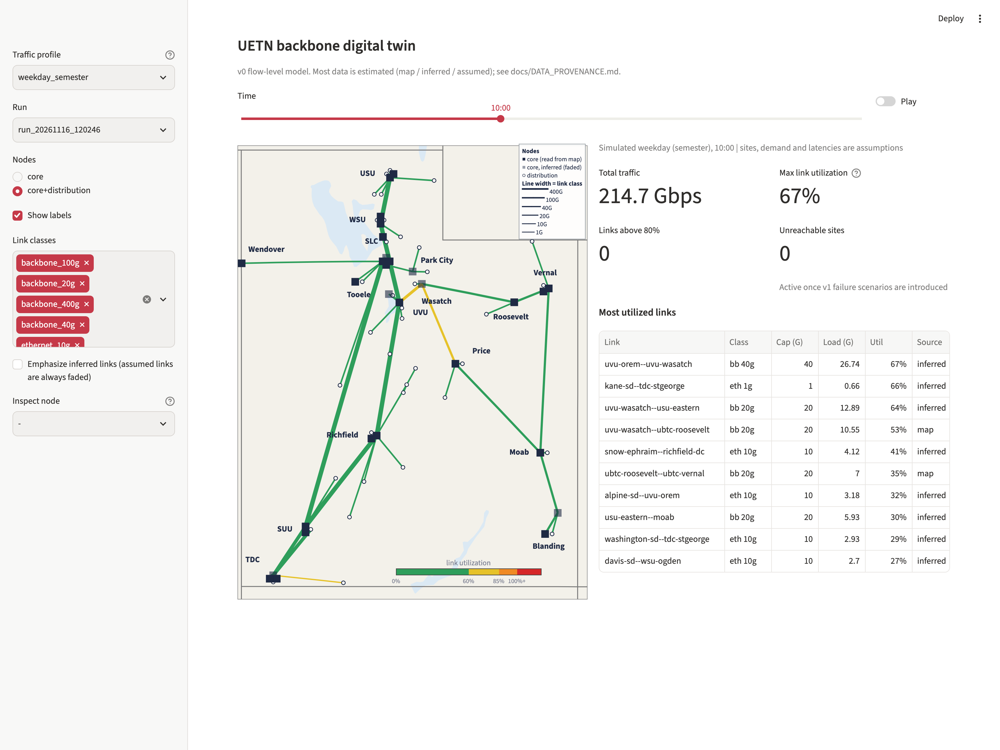
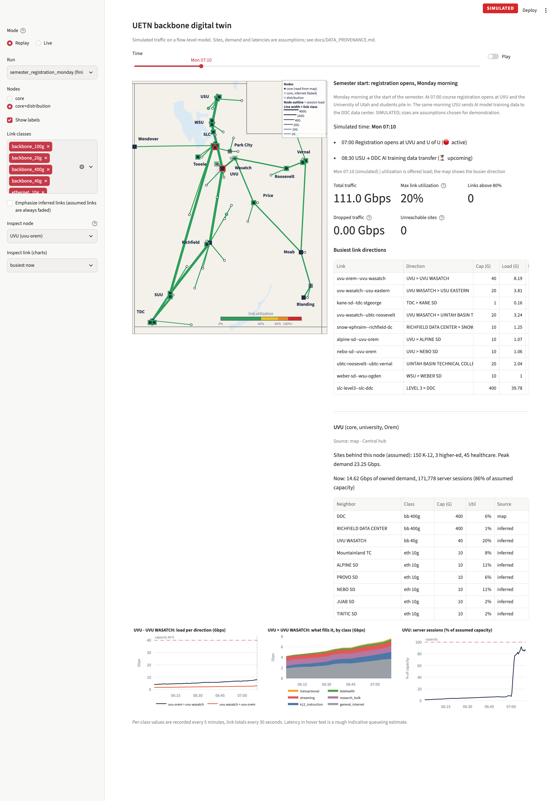

# uetn-twin

A flow-level digital twin of the UETN (Utah Education and Telehealth Network) backbone, with a map-based
monitoring dashboard. It is the first stage of an in-silico benchmark for network management and agentic AI:
a simulated network on which abnormal situations (link cuts, power outages, demand surges, misconfigurations,
DDoS) can later be injected. **v0 covers the backbone graph, normal-day traffic, and the monitoring view only.**
Scope: `docs/WORKORDER_v0.md`.

Fidelity is deliberately low: traffic is modeled as aggregate flows between nodes, not packets. The topology is read
from the UEN|UTN Infrastructure Map (2026-06-04) and a large part of the data is **estimated**; every node and link
carries `confidence: map | inferred | assumed`. See [docs/DATA_PROVENANCE.md](docs/DATA_PROVENANCE.md) for what is
estimated and what to ask UETN, and [docs/GLOSSARY.md](docs/GLOSSARY.md) for network terms.



## Quick start

```bash
# Optional but recommended if the project lives in a synced folder (OneDrive/Dropbox):
export UV_PROJECT_ENVIRONMENT=~/.venvs/uetn-twin

uv sync
uv run uetn-twin validate
uv run uetn-twin simulate --hours 24
uv run streamlit run dashboard/app.py
```

Requires [uv](https://docs.astral.sh/uv/) and Python 3.12+. Run outputs go to `outputs/`; set `UETN_TWIN_OUTPUTS=/some/local/dir` to write them elsewhere (keep them out of cloud-synced folders, especially for live mode).

| Command | What it does |
|---|---|
| `uetn-twin validate` | Checks the YAML data against the schema and consistency rules (links, connectivity). |
| `uetn-twin simulate --hours 24` | Simulates a normal day in 5-minute steps; writes `outputs/run_<time>/snapshots.parquet` and prints a summary. Options: `--start`, `--profile` (`weekday_semester`, `weekend`, `break`). |
| `uetn-twin report --spof` | Single points of failure: what breaks if one link is cut (see below). |
| `uv run streamlit run dashboard/app.py` | Dashboard: map, time slider (with play), KPIs, top links, node details. |
| `uv run python scripts/screenshot.py` | Reproducible dashboard screenshots into `docs/screenshots/` (needs `uv run playwright install chromium` once). |

## How it works

- `data/topology/{nodes,links,sites}.yaml` is the single source of truth. Code only reads it.
- `data/traffic_profile.yaml` holds the demand model (unit demands, concurrency factors, internet exit, hourly
  profiles); `data/physics.yaml` holds the latency constants. All values there are assumptions.
- `src/uetn_twin/`: `schema.py` (Pydantic models), `topology.py`, `traffic.py` (gravity-model traffic matrix),
  `routing.py` (shortest path by delay with ECMP), `backend/` (`NetworkBackend` interface and the `FlowBackend`
  implementation), `engine.py` (fixed-step loop, Parquet output, SPOF report), `cli.py`.
- A different backend (e.g. Containerlab) can later implement the same four methods of `NetworkBackend`
  (`load`, `set_link_state`, `apply_demand`, `observe`) without changing the CLI or the dashboard.

## Changing the topology

The network is plain YAML in `data/topology/`; no code changes are needed. Edit, validate, re-run.

| File | Holds | One record looks like |
|---|---|---|
| `nodes.yaml` | Routers (core PoPs and distribution nodes) | `{id: uvu-orem, name: UVU, tier: core, city: Orem, lat: 40.27, lon: -111.71, kind: university, confidence: map, notes: ''}` |
| `links.yaml` | Undirected links between two nodes | `{id: uvu-orem--uvu-wasatch, a: uvu-orem, b: uvu-wasatch, link_class: backbone_40g, confidence: inferred, notes: ''}` |
| `sites.yaml` | Schools, campuses and clinics behind a node (counts only, not routers) | `{parent: uvu-orem, k12_sites: 10, higher_ed_sites: 1, healthcare_sites: 4, confidence: assumed}` |

Field reference (full schema with descriptions: `src/uetn_twin/schema.py`):

- **`link_class`** sets the capacity: `backbone_400g`, `backbone_100g`, `backbone_40g`, `backbone_20g`, `ethernet_10g`,
  `ethernet_1g`, `microwave_200m`, `ethernet_sub1g`. To use a different capacity, add `capacity_gbps: 80` to the link.
- **`latency_ms`** (optional, one way). If omitted, it is estimated from the distance between the two nodes' `lat`/`lon`
  (constants in `data/physics.yaml`). Add it if you know the real value.
- **`tier`**: `core` or `distribution`. **`kind`**: `pop`, `datacenter`, `university`, `technical_college`,
  `school_district`, `healthcare`, `other`. Scenarios select nodes by these (e.g. `kind:university`).
- **`confidence`**: `map` (read from the UEN|UTN map), `inferred` (our deduction), `assumed` (we made it up). When UETN
  confirms a value, set it to `map` and put the source in `notes`.
- Links are undirected and there is at most one link per pair of nodes. Parallel circuits are modeled as one link whose
  `capacity_gbps` you set to the combined capacity.

### Common edits

| You want to | Do this |
|---|---|
| Fix a link's speed | Change `link_class` (or set `capacity_gbps`) on that link in `links.yaml`. |
| Remove a link that does not exist | Delete its line in `links.yaml`. |
| Add a missing link | Add a line to `links.yaml` with a new unique `id` (convention `node-a--node-b`), `a`, `b`, `link_class`, `confidence`. |
| Re-attach a node to a different PoP | Change `a` or `b` on its link (the `id` should follow). |
| Add a router | Add it to `nodes.yaml`, connect it in `links.yaml`, and add a row in `sites.yaml` if sites sit behind it. A new **core** node must also be listed in exactly one region in `data/regions.yaml`. |
| Remove a router | Delete it from `nodes.yaml`, delete every link that mentions it, delete its `sites.yaml` row. |
| Change how many schools or clinics sit behind a node | Edit its row in `sites.yaml` (demand is computed from these counts and `data/traffic_profile.yaml`). |
| Change the internet exit | `internet_exit_node` in `data/traffic_profile.yaml`. |
| Rename a node or link id | Possible, but search `data/` for the old id first: `data/scenarios/*.yaml` (targets, events), `data/regions.yaml`, `data/traffic_profile.yaml` (`higher_ed_campus_gbps_by_node`). |

### After editing

```bash
uv run uetn-twin validate     # schema errors and consistency checks, listed one per line
uv run pytest -q              # optional safety net
uv run uetn-twin simulate --hours 24
uv run streamlit run dashboard/app.py   # restart the dashboard; choose the new run
```

`validate` also takes `--data <dir>` to check a draft copy of `data/topology` before you replace the real one. It catches a broken network: duplicate ids, links to unknown nodes, two links between the same
pair, a node cut off from the rest, or a distribution node with no path to the internet exit. Saved runs in the output
folder keep the old topology, so re-run a scenario (`uv run uetn-twin run <scenario>` or `live`) to see a change.
The numbers quoted in this README (single points of failure, scenario results, screenshots) were produced with the
topology tagged `v1.0-demo` and will change after you edit it.

Please also record the change in `docs/DATA_PROVENANCE.md` (what changed, who confirmed it, date), so the next reader can
tell what is measured and what is assumed.

## Demand assumption

**Total peak demand assumption: 223.3 Gbps (needs confirmation from UETN).** (258.6 Gbps before v1-platform, when healthcare sites were assumed at 200 Mbps instead of 100 Mbps; see docs/DATA_PROVENANCE.md.)
Peak demand of a node = site count x unit demand x concurrency factor (K-12 0.4, healthcare 0.5, higher-ed 1.0);
see `data/traffic_profile.yaml`. The concurrency factors are not tuned to results. If UETN provides real utilization,
calibrate them first; `docs/DATA_PROVENANCE.md` has a sensitivity table. The internet exit (`slc-level3`) and
`internet_share` (0.7) are exposed in the same file and strongly affect results.

## Modeling assumptions

- **Parallel circuits are one link.** The map shows possible double lines on usu-logan--wsu-ogden and slc--uvu-orem.
  They are modeled as a single link and capacity is not doubled. Parallel circuits in the same conduit fail together,
  so treating them as one is the conservative choice for resilience analysis.
- **Northern chain.** Logan-Ogden-Salt Lake therefore has no alternate path in the model. Whether one exists
  (e.g. via Wyoming) is an open question for UETN.
- **Direction.** Link load is summed over both directions. Internet traffic is mostly downstream, so the value
  approximates downstream utilization and overstates upstream (per-direction modeling is in `docs/BACKLOG.md`).
- **Eastern gateway.** The class of `uvu-orem--uvu-wasatch` is not readable on the map; 40G is an inference
  (20G ran at 140% at peak under the v0.1.1 demand). First question for UETN.
- **Sites.** The map shows representative points only. Districts, charters and clinics not printed on the map are
  attached to the Salt Lake, Ogden and Orem PoPs so that the total is near the map's ~2,100 locations (2,244 here).
- **Offered load.** From v1-platform on, link utilization is the offered load (traffic that wants to cross the link) divided by capacity; above 100% the excess is dropped at each flow's bottleneck link, and downstream links are not reduced.
- Unit demands, concurrency factors, site counts, latencies and coordinates are all assumed.

## Single points of failure (`uetn-twin report --spof`)

For each link: nodes cut off from the internet exit, schools/hospitals affected, and how many *other* links exceed
100% utilization after traffic reroutes (evaluated at weekday peak). This is the input for v1 scenario design.

```text
Single-link failures at weekday peak (sorted by affected sites, then overloaded links)

                       link    link_class  unreachable_nodes  affected_sites  overloaded_after_reroute                                   unreachable
         wsu-ogden--slc-ddc backbone_400g                 14             406                         0 boxelder-sd,btc-brigham,btc-logan,cache-sd...
      uvu-orem--uvu-wasatch  backbone_40g                 16             200                         0  carbon-sd,daggett-sd,duchesne-sd,emery-sd...
       usu-logan--wsu-ogden backbone_400g                  7             147                         0 boxelder-sd,btc-brigham,btc-logan,cache-sd...
        alpine-sd--uvu-orem  ethernet_10g                  1              54                         0                                     alpine-sd
washington-sd--tdc-stgeorge  ethernet_10g                  1              54                         0                                 washington-sd
        davis-sd--wsu-ogden  ethernet_10g                  1              50                         0                                      davis-sd
        weber-sd--wsu-ogden  ethernet_10g                  1              48                         0                                      weber-sd
          nebo-sd--uvu-orem  ethernet_10g                  1              48                         0                                       nebo-sd
        slc-uofu--park-city  ethernet_10g                  3              38                         0               nsummit-sd,park-city,ssummit-sd
        cache-sd--usu-logan  ethernet_10g                  1              36                         0                                      cache-sd

Links whose failure overloads other links after rerouting (v1 scenario candidates, any rank):
  suu-cedar--tdc-stgeorge (backbone_100g) -> overloads: iron-sd--suu-cedar
  uvu-wasatch--ubtc-roosevelt (backbone_20g) -> overloads: uvu-wasatch--usu-eastern
  uvu-wasatch--usu-eastern (backbone_20g) -> overloads: uvu-wasatch--ubtc-roosevelt

Links already above 100% without any failure (excluded from the overload column): none
```

## Scenarios

A scenario is a normal day (base profile) with a situation laid over it: overlays that change one traffic class for
some nodes, and optional events (link up/down). Everything is SIMULATED and every size is an assumption.
`uetn-twin run <scenario>` runs one as fast as possible and writes `run_meta.json`, `link_telemetry.parquet`,
`link_class_telemetry.parquet`, `node_telemetry.parquet`, `totals.parquet` and `events.parquet` under `outputs/`.

| id | Situation |
|---|---|
| `baseline_weekday` | An ordinary semester weekday with regional wiggle and short bursts. |
| `semester_registration_monday` | 07:00 registration opens at UVU and U of U (session overload at U of U); from 08:30 USU sends 30 Gbps of AI training data to DDC. |
| `weekend_dorm_streaming` | Saturday evening: residence-hall streaming flows from SLC (exit and cache) to campuses. |
| `ai_training_campaign` | Several universities run large training transfers on a weekday; the 400G core absorbs them, the edges are the risk. |
| `statewide_k12_testing` | Wednesday morning online assessments: all district nodes rise together. |

## Live mode

```bash
uv run uetn-twin live semester_registration_monday --speed 60    # one simulated minute per real second
uv run streamlit run dashboard/app.py                            # choose "Live" in the sidebar
```

The simulator writes telemetry to `telemetry.sqlite` (WAL) while the dashboard reads it and refreshes every 2.5 s.
Ctrl-C stops the run and keeps what was recorded. When the run ends the SQLite file stays next to the Parquet export.

Keep the output folder **outside OneDrive/Dropbox** (`export UETN_TWIN_OUTPUTS=~/uetn_outputs`): SQLite's WAL mode fails with
`disk I/O error` on cloud-synced folders. The dashboard works offline: the map outline is served from `dashboard/static/`.

## Dashboard

`SIMULATED` is pinned at the top. Sidebar modes: **Replay** (time slider and Play over a saved run) and **Live**
(follows a run in progress). Link color is the busier of the two directions (green below 60%, yellow 60-85%, orange
85-100%, red 100% and above; gray dotted = down); hovering shows both directions, drops and a rough indicative
latency. A node outline shows server-session load in the same colors. The right side has the scenario panel
(overlays: upcoming / active / ended), KPI tiles (total traffic, max utilization, links above 80%, dropped traffic,
unreachable sites), the busiest link directions and a node detail. Below are rolling two-hour charts: load per
direction of a link, what fills it by traffic class, and server sessions of a node. `?run=<scenario>&t=HH:MM&node=<id>`
opens a specific view.



## Tests

```bash
uv run pytest
```

Covers schema and consistency checks, routing (ECMP, reroute, unreachable), traffic conservation, the 24-hour
simulation (including "no link above 100% at normal peak"), the SPOF report, and a dashboard smoke test (first render
without exceptions, time handling, KPI and table logic), plus a live smoke test (a paced run followed by the dashboard).

## Scope

Not in v0: failure scenarios, anomaly detection, agents, MCP tools, evaluation metrics, Containerlab/ns-3 backends,
external (Idaho/Wyoming) sites. See [docs/BACKLOG.md](docs/BACKLOG.md).
